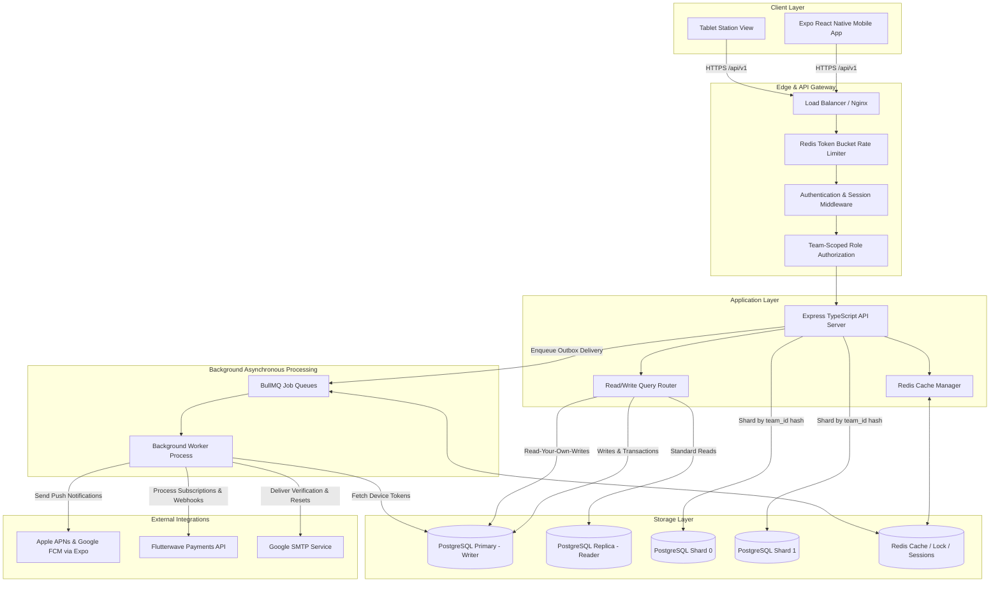
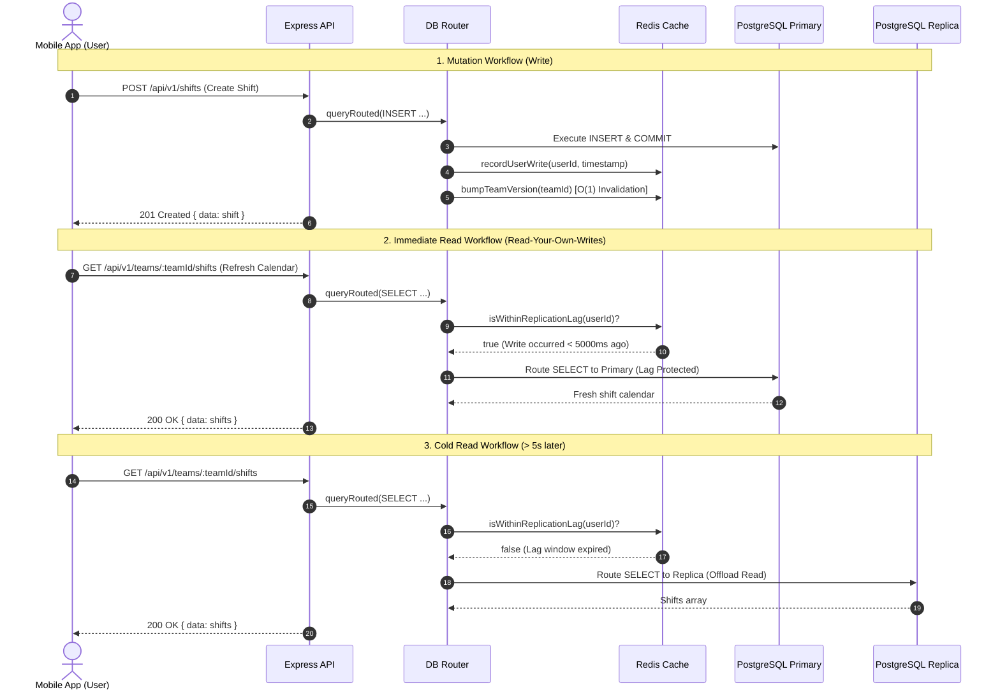

# System Architecture

Rota is a mobile-first shift scheduling platform built for businesses with 5–100 staff per team.

---

## 1. High-Level Architecture Diagram



---

## 2. Core Architectural Principles

### 2.1 Backend Authority
The backend Express API is the sole authority for:
- Authentication & revocable session management (Argon2id + JWT + refresh tokens).
- Multi-tenant isolation and role-based permissions (`OWNER`, `MANAGER`, `STAFF`).
- Shift conflict detection (`existing.start < new.end AND existing.end > new.start`).
- Optimistic concurrency and schedule publication transactions.
- Direct swap approvals and open-shift claim assignments.
- Authoritative subscription state and billing seat calculations.

The mobile application **never** connects directly to PostgreSQL or Redis.

### 2.2 Domain Hierarchy
```text
Business (Billing Boundary)
  └── Team (Scheduling & Authorization Boundary)
       └── TeamMembership (Role Boundary: OWNER, MANAGER, STAFF)
             └── User
```

- **Business**: Owns subscriptions, seat caps, Flutterwave customer tokens, and billing ledgers.
- **Team**: Scopes all shift schedules, swap requests, rosters, and audit activity feeds.
- **TeamMembership**: Dictates a user's role on that specific team. A user can be an `OWNER` on Team 1 and `STAFF` on Team 2.

---

## 3. Storage & Data Routing Architecture



---

## 4. Asynchronous Processing & Outbox Pattern

To protect user requests against external service latency or network downtime:
1. **Durable Intent**: When an event occurs (e.g. shift publication or swap request), durable intent is written to `notifications` and `notification_outbox` inside the main PostgreSQL transaction.
2. **Background Dispatch**: A lightweight BullMQ job is enqueued to Redis (`notification-delivery`).
3. **Worker Execution**: The BullMQ worker claims jobs atomically, checks the recipient's quiet hours and timezone, and delivers push notifications to all registered user devices via Expo Push Service.
4. **Idempotency & Retries**: Failed jobs retry up to 5 times with exponential backoff and jitter. Dead-letter jobs remain inspectable.

---

## 5. Technology Stack Summary

| Layer | Technology | Purpose |
| :--- | :--- | :--- |
| **Mobile** | React Native (Expo SDK 52) | Cross-platform iOS & Android mobile application |
| **Backend Runtime** | Node.js 20 LTS | Asynchronous non-blocking API server |
| **Backend Framework** | Express 4.x + TypeScript | RESTful routing, domain services, middleware |
| **Primary Database** | PostgreSQL 16 | Durable source of truth, ACID transactions, exclusion constraints |
| **Cache & Distributed Lock**| Redis 7 | Transient cache, rate limiting, BullMQ backend, LWW timestamps |
| **Background Queue** | BullMQ | Reliable job execution, retry management, scheduled outbox delivery |
| **Payments** | Flutterwave | Subscription card payments, seat proration, webhooks |
| **Push Notifications** | Expo Push API | Multi-device push notification delivery |
| **Authentication** | Argon2id + JWT + OAuth | Secure password hashing, revocable refresh tokens, Google OAuth |
