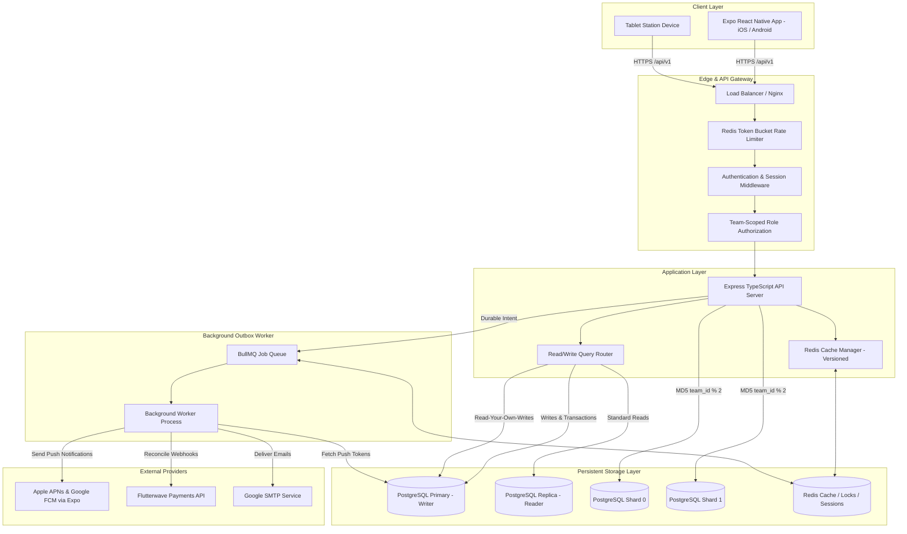

# Rota — Mobile-First Shift Scheduling Platform

Rota is a mobile-first shift scheduling application engineered for small businesses (5–100 staff per team). It provides authoritative shift planning, conflict detection, direct peer swaps, multi-device push notifications with quiet hours, and seat-based subscriptions with immutable audit ledgers.

---

## 1. Deliverables & Project Resources

| Deliverable | Resource Link / File | Description |
|---|---|---|
| **Public GitHub Repository** | [github.com/tomisinligali/rota-mobile-app](https://github.com/tomisinligali/rota-mobile-app) | Monorepo containing both mobile frontend and backend API. |
| **Android Development Build** | [Frontend/eas.json](file:///Users/mac/git/rota-mobile-app/Frontend/eas.json) | Expo Application Services (EAS) configuration for Android APK builds. |
| **Deployed Backend Blueprint** | [render.yaml](file:///Users/mac/git/rota-mobile-app/render.yaml) & [docker-compose.yml](file:///Users/mac/git/rota-mobile-app/docker-compose.yml) | Render Infrastructure-as-Code and Docker Compose orchestration. |
| **System Architecture** | [ARCHITECTURE.md](file:///Users/mac/git/rota-mobile-app/ARCHITECTURE.md) | Full system design, domain boundaries, and storage sequence diagrams. |
| **System State & Matrix** | [STATE.md](file:///Users/mac/git/rota-mobile-app/STATE.md) | Requirement completion matrix, database migrations, and active domain models. |
| **Security Architecture** | [SECURITY.md](file:///Users/mac/git/rota-mobile-app/SECURITY.md) | Threat modeling, tenant isolation, Argon2id auth, and rate limiting. |
| **Database Sharding** | [SHARDING.md](file:///Users/mac/git/rota-mobile-app/SHARDING.md) | 2-shard PostgreSQL architecture, shard key rationale, and scatter-gather queries. |
| **Engineering Learning Log** | [LEARNING-LOG.md](file:///Users/mac/git/rota-mobile-app/LEARNING-LOG.md) | Concurrency race conditions, LWW weaknesses, and cache invalidation strategies. |
| **Test Verification Report** | [TEST_RESULTS.md](file:///Users/mac/git/rota-mobile-app/TEST_RESULTS.md) | Real test outputs for permissions, tenant isolation, and proration math. |
| **Load Test Benchmark** | [LOAD_TEST_REPORT.md](file:///Users/mac/git/rota-mobile-app/LOAD_TEST_REPORT.md) | 200-VU activity feed benchmark report (7.8x speedup with Redis caching). |

---

## 2. System Architecture Diagram



---

## 3. Technology Stack

Following locked stack constraints:

| Layer | Technology | Purpose |
|---|---|---|
| **Mobile Client** | React Native (Expo SDK 54) | Cross-platform iOS and Android mobile app. |
| **Backend API** | Node.js LTS (v20) + Express | Authoritative business logic, validation, and REST API. |
| **Language** | TypeScript (Strict mode) | End-to-end type safety across backend and frontend. |
| **Primary Database**| PostgreSQL 16 | ACID transactions, range indexes, and immutable billing triggers. |
| **Cache & Locks** | Redis 7 | Distributed locking, rate limiting, and versioned entity caching. |
| **Background Queue**| BullMQ (running on Redis) | Outbox job queue for retriable push notifications and webhooks. |
| **Payments** | Flutterwave | Subscription card tokenization and webhook processing. |
| **Push Service** | Expo Push Notifications | APNs (iOS) and FCM (Android) notification dispatch. |

---

## 4. Key Engineering Highlights

### 4.1 Read-Your-Own-Writes Consistency
To prevent users from observing stale data immediately after creating or modifying a shift, [Backend/src/db/router.ts](file:///Users/mac/git/rota-mobile-app/Backend/src/db/router.ts) tracks user write timestamps in Redis (`user_last_write:<userId>`). Any read query dispatched by that user within the 5-second replication lag window is routed to the **Primary database**, ensuring causal consistency before reverting to read replicas.

### 4.2 $O(1)$ Atomic Cache Invalidation
Shift calendars and activity feeds are cached in Redis using versioned namespace keys:
$$\text{Key} = \text{team:}\{\text{teamId}\}\text{:v}\{\text{version}\}\text{:shifts:}\{\text{range}\}$$
When shifts or swaps are modified, the backend atomically increments `team:${teamId}:version` in $O(1)$ time ($<1\text{ ms}$). This avoids dangerous `KEYS` scans on Redis while invalidating all cached ranges instantaneously.

### 4.3 2-Shard PostgreSQL Simulation
Teams are horizontally distributed across two independent PostgreSQL databases (`rota_shard_0` and `rota_shard_1`) based on $\text{MD5}(\text{team\_id}) \pmod 2$. Multi-team operations utilize an asynchronous **Scatter-Gather Engine** that queries shards concurrently and merges result sets in memory.

### 4.4 Exact Integer Proration Math
All subscription upgrades, downgrades, and mid-cycle seat additions are computed using integer cents to eliminate floating-point rounding errors:
$$\text{Charge Today} = \max\left(0, \left\lfloor \frac{\text{New Price} \times \text{Days Rem}}{\text{Period Days}} \right\rfloor - \left\lfloor \frac{\text{Old Price} \times \text{Days Rem}}{\text{Period Days}} \right\rfloor\right)$$
Every financial transaction is appended to an immutable `billing_ledger` table protected by PostgreSQL triggers against `UPDATE` or `DELETE`.

---

## 5. Local Setup & Quickstart

### Prerequisites
- Node.js v20 LTS
- PostgreSQL 16 running on port 5432
- Redis 7 running on port 6379

### 1. Database Initialization
```bash
# Create local databases
createdb rota_dev
createdb rota_shard_0
createdb rota_shard_1

# Run migrations on primary database
cd Backend
npm install
npm run migrate
```

### 2. Start Backend API
```bash
cd Backend
npm run dev
# API listening at http://localhost:5001/api/v1
```

### 3. Start Mobile Frontend
```bash
cd Frontend
npm install
npx expo start
```

---

## 6. Automated Test Suites

Run the test verification suites:

```bash
cd Backend

# 1. Security & RBAC Suite
npx ts-node src/test_security_suite.ts

# 2. Proration & Billing Engine Suite
npx ts-node src/test_proration_and_billing_suite.ts

# 3. Account Idempotency, Pooling & Race Conditions
npx ts-node src/test_account_idempotency_and_pooling.ts

# 4. Push Notifications & Quiet Hours Suite
npx ts-node src/test_notifications_suite.ts

# 5. Settings Coordination Suite (Halima Scenario)
npx ts-node src/test_requirement_7_coordination.ts

# 6. Backend System Design Suite (Sharding, Caching, 200-VU Load Test)
npx ts-node src/test_system_design_suite.ts
```

---

## 7. Android Build & Deployment

### Android Development Build (EAS)
The mobile application is pre-configured for Expo Application Services cloud builds:
```bash
cd Frontend
# Install EAS CLI
npm install -g eas-cli

# Run Android development build
eas build --profile development --platform android
```
The resulting APK can be downloaded and installed directly on any physical Android device or emulator.

### Production Backend Deployment (Docker & Render)
- **Render Blueprint**: Deploy instantly using [render.yaml](file:///Users/mac/git/rota-mobile-app/render.yaml) which provisions an Express Web Service, Managed PostgreSQL, and Managed Redis.
- **Docker Compose**: Run locally or on a cloud VM using [docker-compose.yml](file:///Users/mac/git/rota-mobile-app/docker-compose.yml):
  ```bash
  docker-compose up --build
  ```
